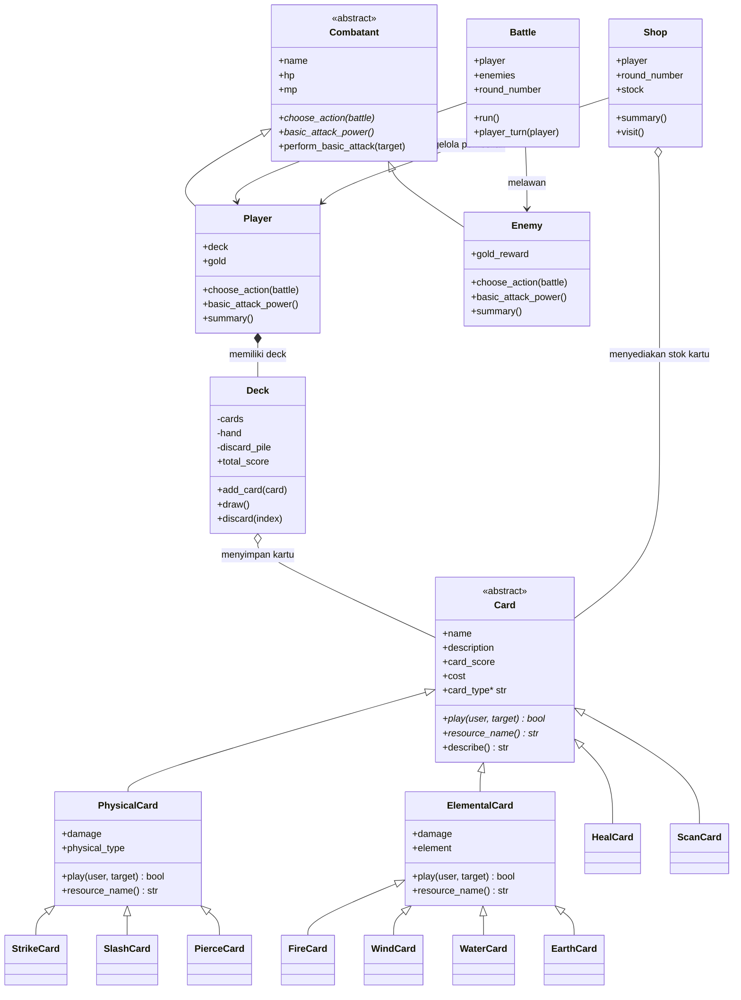
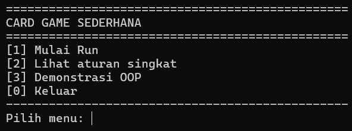
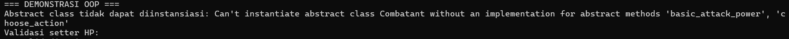
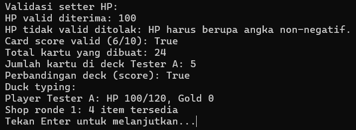

# Card Game Sederhana — (Posttest 3)

## 1. Judul dan Deskripsi Program
Game ini merupakan berbasis Command-Line Interface (CLI) yang dibuat menggunakan Python. Pemain bertarung melawan musuh dalam beberapa ronde dengan menggunakan kartu serangan fisik, kartu elemental, dan kartu support. Pemain memperoleh gold setelah menang, lalu dapat membeli kartu, meningkatkan kemampuan, atau memulihkan HP dan MP di shop.

Program ini menerapkan konsep Pemrograman Berorientasi Objek (PBO), antara lain abstraksi, enkapsulasi, inheritance, polimorfisme, serta relasi antarkelas.

### Cara menjalankan

Pastikan Python 3.10 atau versi lebih baru sudah terpasang. Buka terminal di folder proyek, lalu jalankan:

```bash
python game.py
```

Pilih menu **3 — Demonstrasi OOP** untuk melihat bukti abstract class tidak dapat diinstansiasi dan beberapa demonstrasi konsep OOP.

## 2. Class Diagram dan Relasi

Diagram berikut merangkum kelas-kelas utama serta relasi yang digunakan dalam program.



### Penjelasan relasi

- **Inheritance (pewarisan):** `PhysicalCard` dan `ElementalCard` mewarisi `Card`. Kartu konkret seperti `StrikeCard`, `FireCard`, `HealCard`, dan `ScanCard` mewarisi kelas kartu yang sesuai. `Player` dan `Enemy` mewarisi abstract class `Combatant`.
- **Asosiasi — `Battle` dengan `Player` dan `Enemy`:** `Battle` menyimpan referensi ke pemain dan daftar musuh yang terlibat dalam pertarungan. Objek pemain dan musuh disiapkan di luar objek `Battle`.
- **Agregasi — `Deck` dengan `Card`:** `Deck` menyimpan kumpulan objek kartu. Kartu dapat berpindah antara kumpulan kartu, tangan, dan discard pile; keberadaan kartu tidak semata-mata terikat pada satu objek deck.
- **Komposisi — `Player` dengan `Deck`:** konstruktor `Player.__init__()` membuat deck awal melalui `Deck.starter_deck()` dan menyimpannya sebagai atribut `deck`. Dalam desain program ini, deck merupakan bagian dari state pemain.
- **Relasi `Shop` dengan `Player` dan `Card`:** `Shop` menyimpan referensi pemain untuk transaksi dan menyediakan objek-objek kartu pada atribut `stock`.


## 3. Penerapan Abstraksi dan Polimorfisme

### Abstraksi

Abstraksi digunakan untuk menetapkan antarmuka umum tanpa memaksakan satu implementasi untuk semua turunannya.

- **`Combatant(ABC)`** merupakan abstract class. Method abstraknya adalah `choose_action(battle)` dan `basic_attack_power()`.
- **`Player`** mengimplementasikan `choose_action()` untuk meneruskan giliran ke `battle.player_turn(self)`, sedangkan **`Enemy`** mengimplementasikan `choose_action()` dengan logika AI musuh. Keduanya juga memiliki implementasi `basic_attack_power()` masing-masing.
- **`Card(ABC)`** merupakan abstract class dengan abstract method `play(user, target)`, `resource_name()`, dan abstract property `card_type`. Kelas kartu konkret mengimplementasikan perilaku tersebut sesuai jenis kartunya.

Karena `Combatant` dan `Card` masih memiliki method abstrak, keduanya tidak dapat dibuat menjadi objek secara langsung. Objek harus dibuat dari kelas konkret seperti `Player`, `Enemy`, `StrikeCard`, atau `FireCard`.

### Polimorfisme

- **Polimorfisme melalui inheritance:** `Player.choose_action()` dan `Enemy.choose_action()` memiliki nama method yang sama tetapi perilaku berbeda. Keduanya digunakan sebagai tipe `Combatant` dalam sistem pertarungan.
- **Polimorfisme pada kartu:** method `play()` memiliki implementasi berbeda. `PhysicalCard.play()` menggunakan HP sebagai biaya, `ElementalCard.play()` menggunakan MP untuk menyerang, sedangkan `HealCard.play()` memulihkan HP dan `ScanCard.play()` menampilkan status target.
- **Duck typing:** fungsi `print_summary(item)` hanya memerlukan objek yang mempunyai method `summary()`. Fungsi tersebut dapat menerima objek `Player` maupun `Shop`, walaupun keduanya tidak berada dalam hubungan pewarisan yang sama.
- **Operator overloading:** `Deck.__len__()` memungkinkan pemanggilan `len(deck)`, sedangkan `Deck.__eq__()` memungkinkan perbandingan dua deck dengan operator `==` berdasarkan total card-score.

## 4. Screenshot Output Program

Simpan screenshot asli dari terminal setelah menjalankan program, lalu masukkan gambar ke folder `screenshots/`. Gunakan nama file yang sesuai dengan tautan di bawah ini.

### A. Menu program



### B. Bukti abstract class tidak dapat diinstansiasi

Jalankan menu **3 — Demonstrasi OOP**. Output akan menampilkan pesan bahwa `Combatant` tidak dapat diinstansiasi karena masih mempunyai abstract method. Contoh bentuk output (teks error dapat sedikit berbeda antarversi Python):

```text
=== DEMONSTRASI OOP ===
Abstract class tidak dapat diinstansiasi: Can't instantiate abstract class Combatant ...
```



### C. Bukti validasi dan polimorfisme

Demonstrasi OOP juga menampilkan validasi setter HP, validasi card-score, operator overloading, dan pemanggilan `summary()` melalui duck typing.



> **Penting:** gambar di atas adalah lokasi/placeholder untuk screenshot yang perlu kamu ambil dari program yang benar-benar dijalankan. Jangan menganggapnya sebagai bukti screenshot yang sudah dilampirkan. Buat folder `screenshots`, simpan hasil tangkapan layar dengan nama persis seperti di atas, lalu pastikan gambar ikut dikumpulkan.